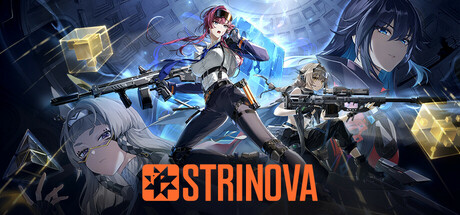

**Strinova by iDreamSky is a stylish tactical shooter where characters can transform into 2D paper form.**

---

## 📖 About

Strinova by iDreamSky is a stylish tactical shooter where characters can transform into 2D paper form. The External provides 3D character position tracking and wallhack-style detection that cuts through the confusion of multi-plane combat involving 2D and 3D enemy states.

## ⚠️ Visibility Problems

| Problem | Status |
|---------|--------|
| 2D paper mode makes enemies nearly invisible against matching wall textures | ✅ Resolved |
| Position tracking lost when enemies transition between 2D and 3D forms | ✅ Resolved |
| Multi-level vertical maps require simultaneous awareness of all floor positions | ✅ Resolved |
| Ability charge states of enemy characters invisible from standard perspective | ✅ Resolved |
| Flank routes through paper mode allow silent repositioning undetectable by sound | ✅ Resolved |

## ✅ Solution

**Strinova External** resolves all visibility and awareness problems with a clean external overlay that never modifies game files.

## 🎯 Features

- Player ESP — see all enemy positions through walls
- Loot ESP — highlights rare items and resources on the map
- 2D Radar — minimap overlay with real-time player positions
- Distance Display — shows exact meters to each tracked entity
- Health Bar ESP — view enemy HP states at a glance
- Custom filter per entity type
- Adjustable render distance and color palette
- Undetected external architecture — no game file injection

## 🚀 Quick Start

1. **Disable Windows Defender** temporarily
2. Get the tool from the button above
3. Launch Strinova
4. Run the overlay as Administrator
5. Configure entity filters via the overlay menu

## 💎 Free vs Pro

| Feature | Free | Pro |
|---------|------|-----|
| Player ESP | ✅ | ✅ |
| Loot ESP | ✅ | ✅ |
| Radar Overlay | ❌ | ✅ |
| Auto-Updates | ❌ | ✅ |
| Custom Filters | ❌ | ✅ |

## 💻 Requirements

- Windows 10 / 11 (64-bit)
- Strinova (any version)
- .NET Framework 4.8+

## 🍎 macOS

## ⚖️ Legal

For educational and research purposes only.

---

